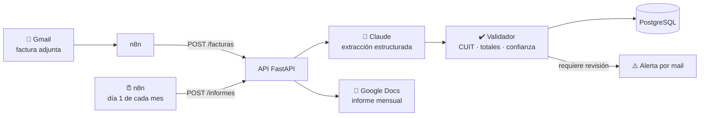

# 🧾 Agente de Facturas y Gastos

> Automatización con IA que lee facturas argentinas, valida sus datos, los guarda en PostgreSQL y genera un informe mensual de gastos en Google Docs.


## 💡 El problema

En una pyme o estudio contable, cargar facturas de proveedores es una tarea manual, repetitiva y propensa a errores: copiar el CUIT, el número de comprobante, los importes, clasificar el gasto y, a fin de mes, armar el resumen a mano.

## ✅ La solución

Este proyecto automatiza todo el circuito:

1. **Recepción:** n8n detecta mails con facturas adjuntas.
2. **Extracción con IA:** un LLM (Claude) lee el PDF o la foto y devuelve los datos en un JSON con esquema fijo.
3. **Validación con reglas de negocio:** el código verifica el dígito verificador del CUIT, que neto + IVA = total en facturas A, la categoría y la confianza de la extracción. **La IA extrae, el código decide.**
4. **Persistencia:** los datos se guardan en PostgreSQL, sin duplicados.
5. **Alertas:** si algo no cierra, la factura queda marcada y llega un aviso por mail.
6. **Informe mensual:** el día 1 de cada mes se genera un Google Doc con el gasto por categoría.

## 🏗️ Arquitectura



## 🛠️ Stack

| Capa | Tecnología |
|---|---|
| Orquestación | n8n |
| API | Python · FastAPI · Pydantic |
| IA | Claude (Anthropic API) con *tool use* para salida estructurada |
| Base de datos | PostgreSQL 16 (tablas normalizadas, vista de resumen, restricción de unicidad) |
| Integraciones | Gmail · Google Docs API · Google Drive API |
| Infraestructura | Docker Compose |
| Calidad | pytest (tests sin necesidad de base de datos ni API key) |

## 🚀 Cómo correrlo

### Requisitos
- Docker y Docker Compose
- (Opcional) una API key de Anthropic y una cuenta de servicio de Google

### 1. Clonar y configurar
```bash
git clone https://github.com/TU-USUARIO/receipts-agent.git
cd receipts-agent
cp .env.example .env
```
Por defecto `LLM_PROVIDER=mock`: el proyecto funciona **sin API key**, con un extractor por reglas que lee las facturas de ejemplo. Para usar IA real, poné `LLM_PROVIDER=anthropic` y tu `ANTHROPIC_API_KEY`.

### 2. Levantar todo
```bash
docker compose up --build
```
- API y documentación interactiva: http://localhost:8000/docs
- n8n: http://localhost:5678

### 3. Probar con una factura de ejemplo
```bash
curl -F "archivo=@samples/factura_a_hosting.txt;type=text/plain" http://localhost:8000/facturas
```

Respuesta:
```json
{
  "proveedor_nombre": "Nube Atlántica S.A.",
  "proveedor_cuit": "30712345671",
  "tipo_comprobante": "A",
  "punto_venta": 3,
  "numero": 1234,
  "fecha_emision": "2026-10-15",
  "neto_gravado": "85000.00",
  "iva": "17850.00",
  "total": "102850.00",
  "categoria": "Tecnología",
  "requiere_revision": false,
  "observaciones": [],
  "id": 1
}
```

Cargá también `samples/factura_a_con_errores.txt` para ver cómo el sistema detecta un CUIT inválido y totales que no cierran.

### 4. Ver el informe del mes
```bash
curl http://localhost:8000/informes/2026/10/texto
```
```
Informe de gastos - Octubre 2026

Facturas procesadas: 4
Total del mes: $ 367.300,00
Pendientes de revisión: 1

Gasto por categoría:
  - Honorarios profesionales: $ 180.000,00 (49,0%, 1 factura)
  - Tecnología: $ 102.850,00 (28,0%, 1 factura)
  - Transporte: $ 61.000,00 (16,6%, 1 factura)
  - Insumos de oficina: $ 23.450,00 (6,4%, 1 factura)

Atención: hay facturas que necesitan revisión manual antes del cierre.
```

### 5. Importar el workflow de n8n
En n8n: **Workflows → Import from file** → `n8n/workflow-facturas.json`. Después conectá tu credencial de Gmail y cambiá `tu-email@ejemplo.com` por tu dirección.

## 📡 Endpoints

| Método | Ruta | Descripción |
|---|---|---|
| `POST` | `/facturas` | Sube una factura (PDF, imagen o texto), la procesa y la guarda |
| `GET` | `/facturas` | Lista facturas (filtros: `desde`, `hasta`, `solo_revision`) |
| `GET` | `/informes/{anio}/{mes}` | Resumen mensual en JSON |
| `GET` | `/informes/{anio}/{mes}/texto` | Resumen mensual en texto |
| `POST` | `/informes/{anio}/{mes}/google-docs` | Publica el informe en Google Docs y devuelve el link |
| `GET` | `/health` | Estado de la API |

## 🧪 Tests
```bash
pip install -r requirements.txt
pytest
```
Los tests usan un repositorio en memoria y el extractor por reglas, así que corren sin base de datos ni API key.

## 📁 Estructura
```
receipts-agent/
├── app/
│   ├── main.py          # API REST (FastAPI)
│   ├── extractor.py     # Agente de extracción (Claude / mock)
│   ├── validators.py    # Reglas de negocio: CUIT, totales, confianza
│   ├── repository.py    # Acceso a datos (PostgreSQL y en memoria)
│   ├── report.py        # Informe mensual y Google Docs
│   ├── models.py        # Modelos Pydantic
│   └── config.py        # Configuración por variables de entorno
├── db/schema.sql        # Esquema de la base
├── n8n/                 # Workflow exportado
├── samples/             # Facturas de ejemplo (datos ficticios)
├── tests/
└── docker-compose.yml
```

## 🧠 Decisiones de diseño

- **Salida estructurada con *tool use*:** en vez de pedirle al modelo "devolvé un JSON" y parsear texto, se le da una herramienta con esquema fijo. Así la respuesta siempre tiene el formato esperado.
- **La IA no tiene la última palabra:** todo lo que extrae el modelo pasa por validaciones deterministas. Si algo no cierra, la factura se guarda igual pero marcada para revisión humana.
- **Idempotencia:** la combinación proveedor + tipo + punto de venta + número es única, así que reprocesar un mail no duplica gastos.
- **Repositorio intercambiable:** la API depende de una interfaz, lo que permite testear sin base de datos.

## 🔮 Próximos pasos
- Soporte para notas de crédito y facturas en dólares con cotización del día
- Dashboard en Looker Studio conectado a PostgreSQL
- Bot de Telegram para mandar fotos de tickets desde el celular

---
Los datos de las facturas de ejemplo son ficticios.
